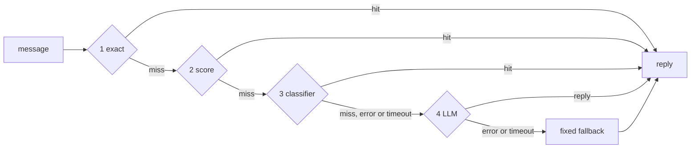
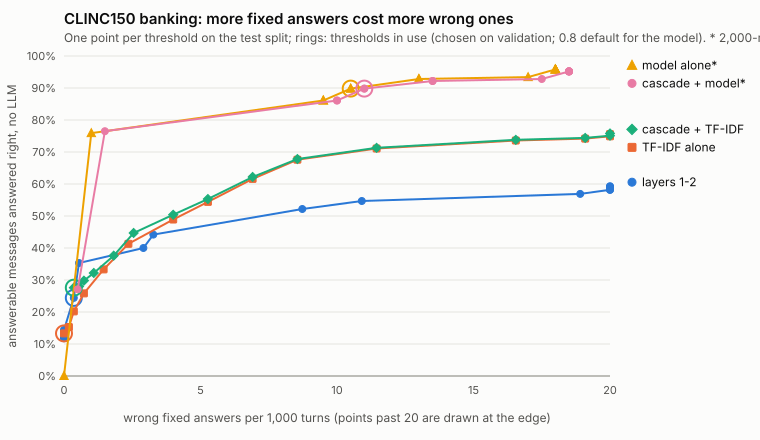

# llm-cascade-router

[](https://github.com/Binarysite/llm-cascade-router/actions/workflows/ci.yml)
[](https://github.com/Binarysite/llm-cascade-router/actions/workflows/codeql.yml)


[](LICENSE)

**Answer each chat message with the cheapest layer that can: an exact match,
local scoring, a cheap classifier, and only then the LLM.**

A support agent gets the same questions all day. This router tries the cheap
layers first, records which one answered and why, and never breaks a turn: a
layer that throws or times out hands the message to the next, and if all fail
the user gets a fixed fallback. It pays off when many messages are repeat
questions with a stable answer, and does little when every turn depends on the
conversation or a lookup.

## Results

Wrong fixed answers first: a fixed answer sent to the wrong question is worse
than a model call.

<!-- output: scripts/headline.mjs -->
```text
                                                        wrong fixed answers  answered without the main LLM
sticker shop, in-sample (49, mock in layer 3)           0 of 31              31/49 (63.3%)
sticker shop, held-out (24, mock in layer 3)            1 of 7               7/24 (29.2%)
sticker shop, held-out (24, deepseek-flash in layer 3)  2 of 11              11/24 (45.8%)
CLINC150 test (5500, layers 1-2 only)                   2 of 112             112/5500 (2.0%); 110 of 450 answerable

deepseek-flash against the keyword mock, same 24 held-out messages: 3 more right, 1 more wrong, none the other way;
not significant (McNemar exact p = 0.25 on right answers).
```

The sticker-shop banks are mine and small, so the real model's held-out gain
over the mock is not significant (the two lines under the table). CLINC150 is
public: thresholds chosen on validation, where layers 1-2 answered only 71
messages, and test scored at the validation-chosen thresholds; re-run once after
a floating-point fix that did not move the thresholds
([History](bench/clinc150/README.md#history), [below](#a-public-benchmark-clinc150)).
Full outputs: [docs/RESULTS.md](docs/RESULTS.md).

## Run it in 30 seconds

Node 22+, no install, no API key. The example is an invented sticker shop with a
keyword mock in the classifier slot and a mock LLM that counts its calls.

```bash
git clone https://github.com/Binarysite/llm-cascade-router.git && cd llm-cascade-router
npm run ask
```

<!-- output: examples/sticker-shop/ask.js -->
```text
sticker-shop example: keyword mock classifier, mock LLM

> How long does shipping take?
  exact      hit   matches phrase "how long does shipping take"
  answered by exact (shipping-time), no LLM call

> how fast do u shiping
  exact      miss  no phrase matches the normalized message
  score      hit   shipping-time 1 via "how fast do you ship", next shipping-cost 0.5
  answered by score (shipping-time), no LLM call

> can I see a mockup to approve first
  exact      miss  no phrase matches the normalized message
  score      miss  best proof 0.286 via "can i see it before you print", below minScore 0.5
  classifier hit   proof at 0.667
  answered by classifier (proof), no LLM call

> My stickers arrived damaged, I want a refund
  exact      miss  no phrase matches the normalized message
  score      miss  best shipping-time 0.286 via "how fast do you ship", next shipping-cost 0.286; shipping-time vetoed by avoid word "damaged"
  classifier miss  shipping-time vetoed by avoid word "damaged"
  llm        hit   no cheaper layer answered
  answered by llm, LLM called
```

`npm run ask -- "are the stickers waterproof?"` prints the full result of one
message as JSON.

## How a message is answered



| Layer | Answers when | Knobs (default) |
|---|---|---|
| 1 `exact` | the normalized message equals one of an answer's `phrases` | none |
| 2 `score` | the Dice similarity of content words clears `minScore` and beats the runner-up by `minMargin` | `minScore` (0.5), `minMargin` (0.1), `maxTokens` (12), `typoTolerance` (true) |
| 3 `classifier` | your `classify` returns a known id with `confidence >= minConfidence` in time | `minConfidence` (0.8), `timeoutMs` (1000) |
| 4 `llm` | your `generate` returns a non-empty reply in time | `timeoutMs` (10000) |

Layers 1 and 2 run in memory with no network. Matching ignores case, accents,
punctuation and one typo in words of five letters or more. An answer's `avoid`
words (exact single words, after synonyms) veto it in layers 2 and 3: a vetoed
best answer is a miss, never a win for the runner-up. Layers 3 and 4 are
optional functions you inject.

## Using it

```bash
npm install github:Binarysite/llm-cascade-router#v0.2.1
```

There is no npm package.

```js
import { createRouter } from 'llm-cascade-router';
import { createOpenAiCompatibleClassifier } from 'llm-cascade-router/openai-compatible';

const router = createRouter({
  answers: [{
    id: 'shipping-time',
    reply: 'Orders ship within 2 business days after you approve the proof.',
    phrases: ['how long does shipping take', 'when will my order ship'],
    avoid: ['damaged', 'late', 'refund'],
  }],
  synonyms: { ship: ['shipping', 'delivery'] },
  stopwords: ['the', 'does', 'my', 'how', 'when'],
  classifier: {
    classify: createOpenAiCompatibleClassifier({
      model: 'deepseek-flash', baseUrl: 'https://api.deepseek.com', apiKey: process.env.DEEPSEEK_API_KEY,
      extraBody: { thinking: { type: 'disabled' } },
    }),
    timeoutMs: 3000,
  },
  llm: { generate: ({ message, context, signal }) => myAgent(message, context, signal) },
  fallback: 'Sorry, I could not answer that. Our team will reply by email.',
  onResult: (r) => log.info(r),
});

const result = await router.route(text, { context, signal });
```

`createRouter` throws `RouterConfigError` listing every config problem; after
that, `route` never rejects. `classify` returns `{ choice, confidence }`
(`choice: null` abstains), `generate` a string or `{ reply, ... }`; both get an
`AbortSignal` for their timeout. Each result has a trace step per layer
([sample](docs/sample-result.json)).

Adapters, all over `fetch`:

- `llm-cascade-router/openai-compatible`: any Chat Completions endpoint. Both
  real-model runs above went through it: the sticker shop with its default
  prompt, CLINC150 with custom `instructions` passed to it
  ([bench/clinc150/model.js](bench/clinc150/model.js)), not the default prompt.
- `llm-cascade-router/claude`: the Anthropic Messages API. Tested against a fake
  `fetch` only; it has not been run against the live API.
- `llm-cascade-router/eval`: `measure`, `format`, a counting mock LLM, Wilson
  and McNemar, for your own bench.

## A public benchmark: CLINC150

[CLINC150](https://github.com/clinc/oos-eval) (Larson et al., 2019, CC BY 3.0)
has 150 intents in 10 domains plus out-of-scope queries, written by crowd
workers. The 15 `banking` intents get a fixed answer each, with their train
utterances as phrases; the other 135 intents and every out-of-scope query must
reach the LLM. `npm run clinc:fetch` downloads it at a pinned commit and checks
its SHA-256; `npm run clinc` reruns it. Setup and history:
[bench/clinc150/README.md](bench/clinc150/README.md).

<!-- output: bench/clinc150/show.js --short -->
```text
CLINC150 test split                   wrong  right    precision, 95% Wilson   on val (right/answered)
layers 1-2                                2  110/450  98.2% (93.7% to 99.5%)  98.6% (92.4% to 99.8%), 70/71
cascade, TF-IDF in layer 3                2  124/450  98.4% (94.4% to 99.6%)  98.6% (92.5% to 99.8%), 71/72
deepseek-flash alone *                   21  149/166  87.6% (81.9% to 91.8%)  -
cascade, deepseek-flash in layer 3 *     22  149/166  87.1% (81.3% to 91.3%)  -
* on a seeded sample of 2000 of the 5500 test messages, minConfidence 0.8 (untuned, no val calls)
```



- **Layers 1 and 2** answer 110 of 450 answerable questions right with 2
  wrong. Only 450 of 5,500 test messages have a fixed answer, so 98% of turns
  still reach the LLM: the saving is bounded by your share of repeat questions.
- **A model in layer 3** finds most answerable questions and pays in wrong
  answers, mostly to messages that had to reach the LLM. Its threshold is the
  untuned default; the curve shows the trade-off a tuned one would pick from.
  Once it is there, layers 1-2 add no right answers (149 either way) and one
  wrong one; they cut cost and latency only
  ([paired numbers](docs/RESULTS.md#clinc150-in-full)).
- **Validation is thin**: the 0.98 rule reads a point estimate on 71 answered
  val messages for layers 1-2, whose 95% interval reaches down to 92.4%; the
  `on val` column shows it next to test.
- **`npm run cost`** gives dollars per 1,000 turns, p50/p95 latency and the
  main-call price below which the model in layer 3 loses money. A wrong fixed
  answer skips a main call too: the output says how many saved calls are wrong
  answers, and `--wrong-cost` prices them
  ([example](docs/RESULTS.md#cost-per-1000-turns)).

## Measure your own messages

The method carries over, the numbers do not: label real messages, keep some
aside, run them, read `wrong`, then the share.

```bash
npm run measure                  # the starter in examples/starter: 10 messages, 3 answers
npm run measure -- --config my-config.json --messages my-messages.json --verbose
```

It runs layers 1 and 2 on a JSON config and a list of `{ "text", "expect" }`
(`expect`: an answer id or `"llm"`); exit 1 on a wrong fixed answer. For layer
3, use `llm-cascade-router/eval` in code.

## Limits

- **Every threshold and default here is an example value** for the data it was
  picked on, and every number is one run: tune and measure on your own
  messages. The sticker-shop banks are 73 messages I wrote; the main LLM slot is
  a mock in every bench.
- One message at a time: "yes, that one" reaches the LLM.
- Several questions in one message get at most one fixed answer.
- Classifier confidence is not calibrated: set `minConfidence` from a bench.
- Fixed answers are static strings, and the router is not a safety layer: put
  injection and personal-data checks before it.

Decisions, threat model and the rest of the limits: [docs/DESIGN.md](docs/DESIGN.md).

## Development

```bash
npm ci && npm test && npm run lint
npm run typecheck   # strict tsc on src/, conformance of the .d.ts files
npm run coverage    # floor of 95% lines, 90% branches on src/
npm run bench -- --verbose
```

CI runs the same on Node 22 and 24, reruns the CLINC150 local bench against the
committed report, checks that the output blocks in this README match fresh
runs, and runs CodeQL.

## About

The chat agent this comes from is in a live pilot on demo sites for prospective
clinics; no paying clinic yet. This repo is written from scratch around an
invented sticker shop. Built with Claude Code; the design decisions and reviews
are mine. Status: v0.2.1, not on npm. Using it with
[agent-eval-harness](docs/agent-eval-harness.md).

Author: Alfredo Rosadilla ([@Binarysite](https://github.com/Binarysite)). MIT license, see [LICENSE](LICENSE);
copyright AURELIAI SpA, which owns the code the router was extracted from. Third-party data: [NOTICE](NOTICE).
[Changelog](CHANGELOG.md), [security policy](SECURITY.md), [contributing](CONTRIBUTING.md).
