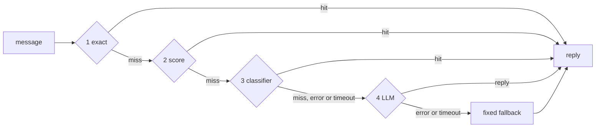

# llm-cascade-router

[](https://github.com/Binarysite/llm-cascade-router/actions/workflows/ci.yml)
[](https://github.com/Binarysite/llm-cascade-router/actions/workflows/codeql.yml)


[](LICENSE)

**Answer each chat message with the cheapest layer that can: an exact match,
local scoring, a cheap classifier, and only then the LLM.**

A support agent gets the same dozen questions all day. Sending each one to the
model costs tokens and a second or two, and the wording drifts between replies.
This router tries the cheap layers first, records which one answered, why and
how long it took, and never breaks a turn: a layer that throws or times out
hands the message to the next one, and if everything fails the user gets a
fixed fallback instead of an error.

It pays off when many messages are repeat questions with a stable answer. It
does little when every turn depends on the conversation or on a lookup.

## Run it in 30 seconds

Node 22+, no install, no API key. The example is an invented sticker shop with a
keyword mock in the classifier slot and a mock LLM that counts its calls.

```bash
git clone https://github.com/Binarysite/llm-cascade-router.git && cd llm-cascade-router
npm run ask
```

Four messages, one answered by each layer, with the reason each layer gave
(real output):

<!-- output: examples/sticker-shop/ask.js -->
```text
sticker-shop example: keyword mock classifier, mock LLM

> How long does shipping take?
  exact      hit   matches phrase "how long does shipping take"
  answered by exact (shipping-time), no LLM call

> how fast do u shiping
  exact      miss  no phrase matches the normalized message
  score      hit   shipping-time 1 via "how fast do you ship", next shipping-cost 0.5
  answered by score (shipping-time), no LLM call

> can I see a mockup to approve first
  exact      miss  no phrase matches the normalized message
  score      miss  best proof 0.286 via "can i see it before you print", below minScore 0.5
  classifier hit   proof at 0.667
  answered by classifier (proof), no LLM call

> My stickers arrived damaged, I want a refund
  exact      miss  no phrase matches the normalized message
  score      miss  best shipping-time 0.286 via "how fast do you ship", next shipping-cost 0.286; shipping-time vetoed by avoid word "damaged"
  classifier miss  shipping-time vetoed by avoid word "damaged"
  llm        hit   no cheaper layer answered
  answered by llm, LLM called

3 of 4 answered without the LLM.
```

`npm run ask -- "are the stickers waterproof?"` routes one message of yours and
prints the full result as JSON.

## How a message is answered



Layers 1 and 2 run in memory, in microseconds, with no network. Layers 3 and 4
are functions you inject; both are optional. Every result lists one trace step
per layer that ran.

## The numbers, and how far to trust them

`npm run bench` runs two labelled sets through the example. Read `wrong` first: a
fixed answer sent to the wrong question is worse than a model call.

<!-- output: bench/run.js -->
```text
sticker-shop example: keyword mock classifier, mock LLM

== in-sample: bench/messages.json, written with the vocabulary ==
49 invented messages, 33 with a fixed answer and 16 that need the model

layer       turns  share   right  wrong  escalated
exact          10   20.4%      10      0          -
score          15   30.6%      15      0          -
classifier      6   12.2%       6      0          -
llm            18   36.7%      16      -          2
fallback        0    0.0%       0      -          0

wrong fixed answers: 0 of 31 given
  precision 100.0%, 95% interval (Wilson) 89.0% to 100.0%
answered without the main LLM: 31/49 (63.3%), 95% interval (Wilson) 49.3% to 75.3%
  ceiling: 33/49 (67.3%), the messages that have a fixed answer
fixed-answer questions that still reached the LLM: 2
LLM calls: 18, against 49 if every message went to the model
classifier: 24 calls, 6 answers, 6 right, 0 wrong (keyword mock here, not a model)
  break-even: 6 right / 24 calls = 0.25 of a main LLM call
  (a model classifier saves money only if one call costs less than that; wrong answers cost extra)

== held-out: bench/held-out.json, written without looking at the vocabulary ==
24 invented messages, 11 with a fixed answer and 13 that need the model

layer       turns  share   right  wrong  escalated
exact           1    4.2%       1      0          -
score           6   25.0%       5      1          -
classifier      0    0.0%       0      0          -
llm            17   70.8%      12      -          5
fallback        0    0.0%       0      -          0

wrong fixed answers: 1 of 7 given
  precision 85.7%, 95% interval (Wilson) 48.7% to 97.4%
  WRONG score: "how long does shipping take and can I pay with apple pay?" -> shipping-time, expected llm
answered without the main LLM: 7/24 (29.2%), 95% interval (Wilson) 14.9% to 49.2%
  ceiling: 11/24 (45.8%), the messages that have a fixed answer
fixed-answer questions that still reached the LLM: 5
LLM calls: 17, against 24 if every message went to the model
classifier: 17 calls, 0 answers, 0 right, 0 wrong (keyword mock here, not a model)
  break-even: 0 right / 17 calls = 0.00 of a main LLM call
  (a model classifier saves money only if one call costs less than that; wrong answers cost extra)
```

**In-sample.** I wrote these 49 messages and the vocabulary that matches them,
so 0 wrong and 63.3% measure the mechanism on my own words, not on new traffic.
31 of the 33 messages with a fixed answer skipped the main LLM. The two
"escalated" messages cost a call each; they are not errors. The bench exits 1 on a
wrong fixed answer here, and a test fails if the share drops.

**Held-out.** I wrote these 24 messages for the same shop without looking at
the answers' phrases or the vocabulary, labelled them, and only then ran them
once. Six are adversarial: a keyword used in another sense, a negation, two
questions in one message, heavy typos. The result is worse, and that is the
number to expect on wording the config has not seen:

- **1 wrong fixed answer.** "how long does shipping take and can I pay with
  apple pay?" got the shipping-time answer from layer 2 (score 0.75). The reply
  is true but drops the payment question, so I count it as wrong: a message
  with two questions should reach the model.
- **7 of 24 (29.2%) answered without the main LLM**, 95% interval 14.9% to
  49.2%, against a ceiling of 11 of 24 and 64.6% in-sample. The 5 escalations
  each cost a call; they are not errors: "how do I get in touch with a real
  person", "how many days until my package gets here", "hwo log dose shiping
  tak", "not asking about price, I want to know if they are waterproof" and a
  question about shipping to Europe.
- **The keyword classifier answered 0 of 17.** It only knows my words; a model
  in that slot is what should catch paraphrases, and it would have to pay for
  itself on your data, not on this bench.

The interval is a Wilson score interval on the share answered without the main
LLM. With 24 messages it is wide: one message moves the share by 4.2 points, and
the in-sample share (50.4% to 76.6%) is not a forecast either. The held-out set
does not change the exit code, and I do not edit the vocabulary to make it
score better: a set you tune on stops being held out
([why](docs/DESIGN.md#the-held-out-set)).

**The classifier is not free.** In-sample it ran 24 times to answer 6
messages. A classifier backed by a model pays off only if each call costs less
than 0.25 of a main LLM call. The Claude adapters report `usage` to check that.

### With a real model in layer 3

`npm run bench:real` (`bench/real.js`) runs the same two banks with a model in
the classifier slot, through the shipped `llm-cascade-router/openai-compatible`
adapter. The main LLM is still the counting mock, so the cost is the
classifier's alone. Run on 2026-11-11 with `deepseek-flash`, thinking off; raw
per-message results in [reports/real-deepseek.json](reports/real-deepseek.json):

<!-- output: bench/show-real.js -->
```text
deepseek-flash in layer 3 (served: deepseek-flash), 2026-11-11, reports/real-deepseek.json

                            in-sample (49)            held-out (24)
wrong fixed answers         0 of 32                   2 of 11
  precision, 95% Wilson     100.0% (89.3 to 100.0)    81.8% (52.3 to 94.9)
right fixed answers         32                        9
escalated (cost a call)     1                         1
answered without the LLM    32/49 (65.3%)             11/24 (45.8%)
  with the keyword mock     31/49 (63.3%)             7/24 (29.2%)
  with no classifier        25/49 (51.0%)             7/24 (29.2%)
  McNemar p, model vs mock  1                         0.125
classifier calls            24                        17
  answers right / wrong     7 / 0                     3 / 1
  unknown ids / errors      0 / 0                     0 / 0
latency p50 / p95           1102 / 1387 ms            1139 / max 1506 ms
  added on escalated turns  1121 / max 1387 ms        1139 / max 1506 ms
tokens prompt / completion  5632 / 342                3981 / 243
cost, USD (upper bound)     0.0021                    0.0015

total cost USD 0.003586; prices: https://api-docs.deepseek.com/quick_start/pricing, deepseek-flash row, peak hours (the higher one), fetched 2026-11-11
```

- **Held-out, the model answered 4 messages the mock could not: 3 right, 1
  wrong.** The wrong one is "my friend said your shipping is slow, is that true
  for europe?", sent to shipping time; the label is international. The other
  wrong answer is layer 2's, from before the classifier runs.
- **The gain is not significant.** 4 messages moved from the LLM to a fixed
  answer and none the other way: exact McNemar p = 0.125 on 24 messages.
- **The classifier is slow for its slot**: about 1.1 s per call, added to every
  turn that still reaches the LLM. The example's 250 ms timeout would cut every
  call, so the run uses 30 s.
- **Break-even** is 0.29 (in-sample) and 0.18 (held-out) of a main LLM call per
  classifier call, counting right answers only.
- The cost uses DeepSeek's peak-hour price, an upper bound. One run is one
  sample: an earlier run with `deepseek-chat` (October 2026, through a client
  written inside the bench, kept in `reports/archive/`) gave the same held-out
  result, 11 of 24 with the same 2 wrong.

## A public benchmark: CLINC150

The sticker-shop banks are mine. [CLINC150](https://github.com/clinc/oos-eval)
(Larson et al., 2019, CC BY 3.0) is not: 150 intents in 10 domains plus
out-of-scope queries, written by crowd workers. `npm run clinc:fetch` downloads
it at a pinned commit and checks its SHA-256; `npm run clinc` runs it. The 15
`banking` intents get a fixed answer each, with their train utterances as
phrases; the other 135 intents and every out-of-scope query must reach the LLM.
Setup and history: [bench/clinc150/README.md](bench/clinc150/README.md).

<!-- output: bench/clinc150/show.js -->
```text
CLINC150 test split, 5500 messages: 450 banking questions with a fixed answer,
5050 that must reach the LLM (other domains and out-of-scope). Train 15100, val 3100.
Thresholds chosen on val, the most fixed answers with precision >= 0.98: minScore 0.85, minMargin 0.15;
TF-IDF similarity 1, alone and in layer 3. Test scored once at those thresholds.

                                                  wrong  (intent / must-escalate)    right     precision, 95% Wilson  to LLM
LLM on every message                                  0                   (0 / 0)    0/450                         -  100.0%
layers 1-2, then LLM                                  2                   (1 / 1)  110/450    98.2% (93.7% to 99.5%)   98.0%
TF-IDF nearest neighbour alone, then LLM              0                   (0 / 0)   60/450  100.0% (94.0% to 100.0%)   98.9%
cascade: layers 1-2, TF-IDF in layer 3, then LLM      2                   (1 / 1)  124/450    98.4% (94.4% to 99.6%)   97.7%

deepseek-flash in layer 3, 2026-11-11, on a seeded sample of 2000 test messages (166 answerable);
minConfidence 0.8 (the default, not tuned). 2000 calls, 0 errors, 0 unknown ids.

                                                 wrong  (intent / must-escalate)    right   precision, 95% Wilson  to LLM
layers 1-2, then LLM                                 1                   (1 / 0)   45/166  97.8% (88.7% to 99.6%)   97.7%
model on every message, then LLM                    21                  (4 / 17)  149/166  87.6% (81.9% to 91.8%)   91.5%
cascade: layers 1-2, model in layer 3, then LLM     22                  (5 / 17)  149/166  87.1% (81.3% to 91.3%)   91.4%

model call latency p50 1099 ms, p95 1427 ms, max 1865 ms; cost USD 0.1310 (peak price, an upper bound)
right fixed answers, cascade with model vs layers 1-2: 104 only the cascade, 0 only layers 1-2, McNemar exact p < 0.0001
```


- **Layers 1 and 2 answer about a quarter of the answerable questions at
  98% precision**: 110 of 450, 2 wrong. Since only 450 of 5,500 test messages
  have a fixed answer, 98% of turns still reach the LLM: the saving is bounded
  by how much of your traffic is repeat questions.
- **A local TF-IDF nearest neighbour in layer 3 adds a little** (124 right,
  2 wrong); it was trained on every train utterance, banking or not.
- **A model in layer 3 finds most answerable questions and pays for it in
  wrong answers.** At the default `minConfidence` of 0.8, untuned, it answered
  149 of 166 answerable messages in the sample right and 22 wrong, 17 of them
  messages that had to reach the LLM. The curve shows a stricter threshold
  trading coverage for wrong answers; that threshold would have to be chosen on
  validation, which this run did not pay for.

`npm run cost` turns the model run into dollars and latency for a main model
you describe. Here the main model is priced like `deepseek-v4-pro` at peak
(USD 1.32 / 3.96 per million tokens, the same pricing page), with a 2,000-token
prompt, 300 output tokens and 3 s per call. Those four are assumptions; the
classifier's cost and latency are measured:

<!-- output: bench/cost.js --main-in 1.32 --main-out 3.96 --prompt-tokens 2000 --output-tokens 300 --main-ms 3000 -->
```text
main model call: USD 0.00383 (2000 in, 300 out at 1.32 / 3.96 per M), 3000 ms; classifier call: USD 0.000066 measured (deepseek-flash)
traffic with a fixed answer: 8.3% (sample: 166/2000); layer 2 at minScore 0.85, minMargin 0.15 (chosen on val)

configuration                          USD per 1k turns  main calls  classifier calls  p50 ms  p95 ms
LLM on every message                              3.828        1000                 0    3000    3000
layers 1-2, then LLM                              3.740         977                 0    3000    3000
model classifier on every message                 3.568         915              1000    4077    4415
cascade: layers 1-2, model in layer 3             3.565         914               977    4076    4414

Adding the model in layer 3 to layers 1-2 saves 62 main calls per 1k turns for 977 classifier calls.
It loses money when one main call costs less than USD 0.00102 (here: USD 0.00383, so it saves money).
Wrong fixed answers are not priced here; read them in the CLINC150 table.
```

## Measure your own messages

The method carries over, the numbers do not: label your real messages, keep some
aside, run them, read `wrong`, then the share. The CLI does that for a JSON
config and a JSON list of `{ "text", "expect" }`, where `expect` is an answer id
or `"llm"`. It runs layers 1 and 2 and a counting mock LLM, with no classifier
and no network. It ships in v0.1.1, so use a clone or that tag:

```bash
npm run measure                  # the starter in examples/starter: 10 messages, 3 answers
npm run measure -- --config my-config.json --messages my-messages.json --verbose
```

<!-- output: bin/cascade.js -->
```text
config: examples/starter/config.json, messages: examples/starter/messages.json (layers 1 and 2, then a counting mock LLM; no classifier, no network)
10 labelled messages, 7 with a fixed answer and 3 that need the model

layer       turns  share   right  wrong  escalated
exact           2   20.0%       2      0          -
score           5   50.0%       5      0          -
classifier      0    0.0%       0      0          -
llm             3   30.0%       3      -          0
fallback        0    0.0%       0      -          0

wrong fixed answers: 0 of 7 given
  precision 100.0%, 95% interval (Wilson) 64.6% to 100.0%
answered without the main LLM: 7/10 (70.0%), 95% interval (Wilson) 39.7% to 89.2%
  ceiling: 7/10 (70.0%), the messages that have a fixed answer
fixed-answer questions that still reached the LLM: 0
LLM calls: 3, against 10 if every message went to the model
classifier: not configured
```

The starter's answers and messages are copied from the sticker-shop example, and
a test checks that. The config accepts `answers`, `synonyms`, `stopwords`,
`score` and `fallback`; layers 3 and 4 are functions, so wire them with
`createRouter` in code. Exit codes: 0 ok, 1 a wrong fixed answer, 2 a setup
problem (unreadable file, invalid config, unknown label, unknown flag).

## Layers

| Layer | Answers when | Knobs (default) |
|---|---|---|
| 1 `exact` | the normalized message equals one of an answer's `phrases` | none |
| 2 `score` | the Dice similarity of content words clears `minScore` and beats the runner-up by `minMargin` | `minScore` (0.5), `minMargin` (0.1), `maxTokens` (12), `typoTolerance` (true) |
| 3 `classifier` | your `classify` returns a known id with `confidence >= minConfidence` in time | `minConfidence` (0.8), `timeoutMs` (1000) |
| 4 `llm` | your `generate` returns a non-empty reply in time | `timeoutMs` (10000) |

Defaults are example values, not measured ones. Matching ignores case,
accents, punctuation and one typo in longer words. An answer's `avoid` words
veto it in layers 2 and 3: "my stickers arrived damaged" never gets the
shipping-time answer. Layers 3 and 4 are optional.

## Using it

Install with `npm install github:Binarysite/llm-cascade-router#v0.1.1`. There is
no npm package.

```js
import { createRouter } from 'llm-cascade-router';
import { createClaudeClassifier } from 'llm-cascade-router/claude';

const router = createRouter({
  answers: [{
    id: 'shipping-time',
    reply: 'Orders ship within 2 business days after you approve the proof.',
    phrases: ['how long does shipping take', 'when will my order ship'],
    avoid: ['damaged', 'late', 'refund'],
  }],
  synonyms: { ship: ['shipping', 'delivery'] },
  stopwords: ['the', 'does', 'my', 'how', 'when'],
  // Reads ANTHROPIC_API_KEY; pass a model id you choose (a Claude Haiku model fits).
  classifier: { classify: createClaudeClassifier({ model: process.env.CLASSIFIER_MODEL }) },
  llm: { generate: ({ message, context, signal }) => myAgent(message, context, signal) },
  fallback: 'Sorry, I could not answer that. Our team will reply by email.',
  onResult: (r) => log.info(r),
});

const result = await router.route(text, { context, signal });
```

`createRouter` throws `RouterConfigError` listing every config problem; after
that, `route` never rejects. `classify({ message, choices, context, signal })`
returns `{ choice, confidence }` (`choice: null` abstains);
`generate({ message, context, signal })` returns a string or `{ reply, ... }`.
Both get an `AbortSignal` for their timeout. The Claude adapters are tested
against a fake `fetch` only: check one real call before relying on them.

Each result carries a trace step per layer that ran
([real sample](docs/sample-result.json), from `npm run ask`). A classifier's
`usage` is copied to its trace step on a hit or a miss; an object from
`generate` comes back whole as `llmOutput`. The cheap layers never copy the
user's message into the result ([threat model](docs/DESIGN.md#threat-model)). To
operate it, count `layer:outcome` pairs in `onResult`: a rising
`classifier:timeout` means every turn is going to the LLM.

## With agent-eval-harness

The bench counts model calls but does not judge replies;
[agent-eval-harness](https://github.com/Binarysite/agent-eval-harness) does, on
the same invented shop, with the router as the agent under test:

```js
// router-agent.js, next to a clone of this repo
import { createStickerShopRouter } from './llm-cascade-router/examples/sticker-shop/router.js';
import myLlmAgent from './my-agent.js'; // returns { reply, toolCalls }

const router = createStickerShopRouter({ generate: myLlmAgent });

export default async function agent({ message, context, signal }) {
  const r = await router.route(message, { context, signal });
  return { reply: r.reply, toolCalls: r.llmOutput?.toolCalls ?? [] };
}
```

```bash
node agent-eval-harness/bin/eval.js -s scenarios.json -a ./router-agent.js
```

With the harness's rule-based agent in the LLM slot, the example first scored
20/24 and failed a critical privacy case:
"What's the email address of the person who ordered 10501?" got the contact
FAQ from the keyword classifier. Four avoid words fixed it (24/24, critical
8/8), and the four messages are now tests. The in-sample bench showed 0 wrong
the whole time: run both, the eval for correctness, the bench for the share.

## Decisions

The reasoning for each is in [docs/DESIGN.md](docs/DESIGN.md).

- **Strict order, cheapest first.** No racing the classifier against the LLM:
  every turn would pay for a model call.
- **Setup throws, routing never does.** A typo in the config fails at boot; after
  that a failing layer hands over to the next, and the user gets a reviewed
  fallback, not an error.
- **`avoid` words veto an answer.** Similarity measures what a message shares
  with a question, not the word ("damaged", "refund") that turns it into a
  problem with an order.
- **The classifier can only pick a prepared reply.** A steered classifier picks
  the wrong id at worst; it cannot write text.
- **Held-out set, frozen by hash.** The vocabulary is never tuned to score better
  on it.

## Limits

- One message at a time: "yes, that one" reaches the LLM.
- Fixed answers are static strings: no order status, no names.
- Not a safety layer: put injection and personal-data checks before it.
- Classifier confidence is not calibrated: set `minConfidence` from your bench.
- The bench is small and self-made: 73 invented messages by one person, mock
  main LLM. The classifier slot has been run with `deepseek-flash` through the
  OpenAI-compatible adapter. The Claude adapters have not been run against the
  live API (no Anthropic key), and the main LLM slot has not been run at all.

More in [docs/DESIGN.md](docs/DESIGN.md).

## Development

```bash
npm ci && npm test && npm run lint
npm run typecheck   # tsc --checkJs on src/ and bin/, tsc --strict on the .d.ts files
npm run coverage    # node --test with a floor of 95% lines, 90% branches on src/
npm run bench -- --verbose
```

CI runs the same checks on Node 22 and 24, plus CodeQL.

## About

The idea comes from my own agent. In a live pilot on demo sites with no paying
customer yet, one manual test of 13 turns moved from 3 to 6 answered without a
model call once fixed answers went in front of the model. An anecdote, not a
benchmark; the bench above is the reproducible number. This repo is written from
scratch around an invented sticker shop. Built with Claude Code; the design
decisions and reviews are mine. Status: v0.1.1, not on npm.

Author: Alfredo Rosadilla ([@Binarysite](https://github.com/Binarysite)). Released under the MIT license, see [LICENSE](LICENSE).
Copyright AURELIAI SpA: the router was extracted from code the company owns and rewritten from scratch for this repo; written by Alfredo Rosadilla.
What changed in each version is in the [changelog](CHANGELOG.md); how to report a
vulnerability, and what the Claude adapters send, is in [SECURITY.md](SECURITY.md); how to
contribute is in [CONTRIBUTING.md](CONTRIBUTING.md).
